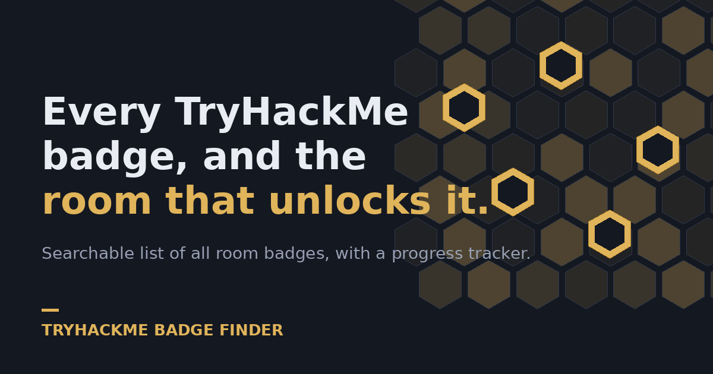
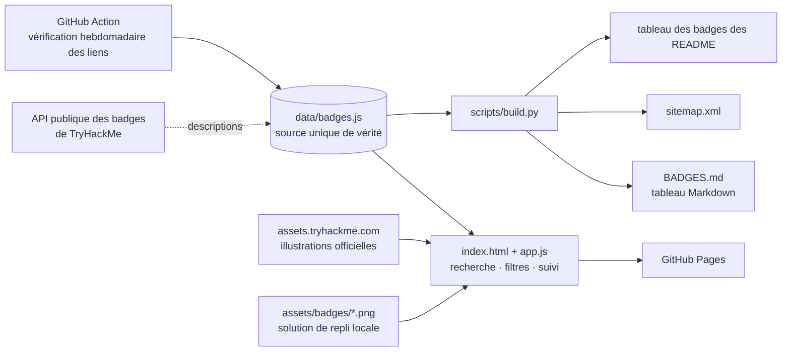
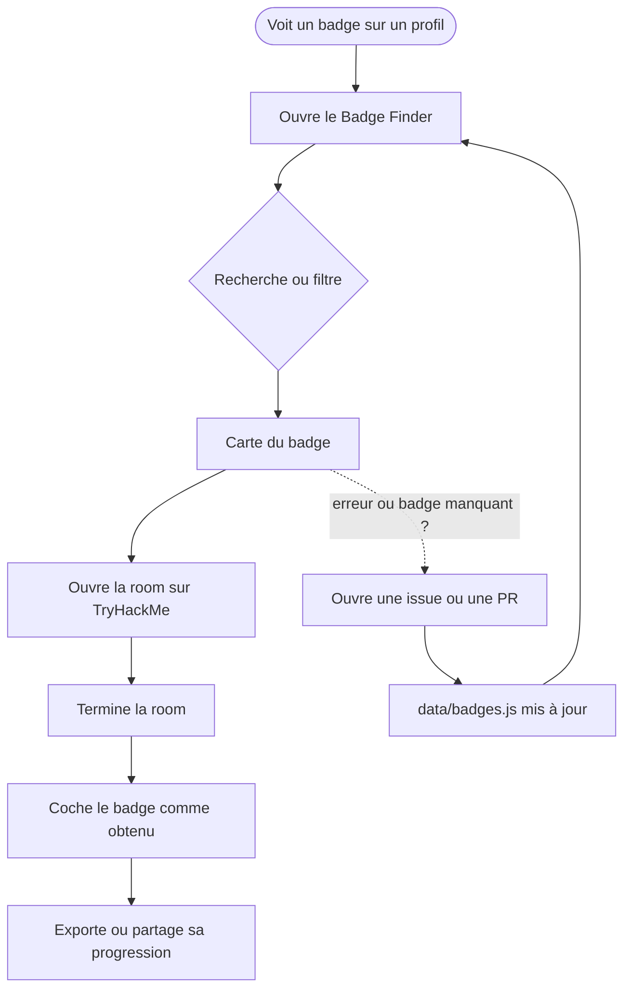
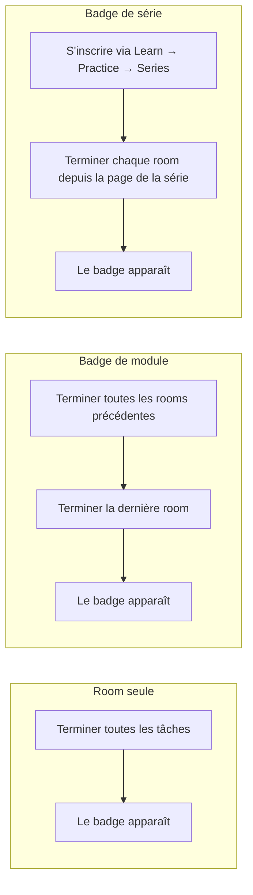
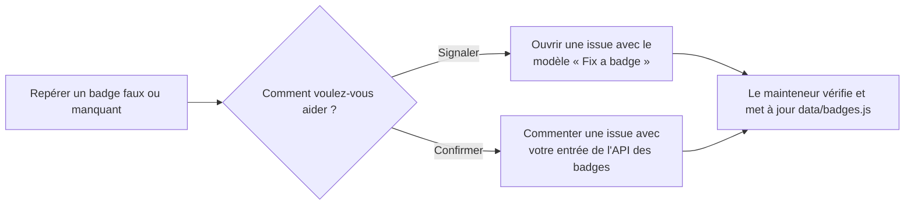

<div align="center">



# TryHackMe Badge Finder

[](README.fr.md)
[](README.md)

**Chaque badge TryHackMe, et la room exacte qui le débloque.**

[](https://bazeeza.github.io/thm-badge-finder/)
[](#tableau-des-badges)
[](BADGES.md)
[](https://github.com/bazeeza/thm-badge-finder/actions/workflows/validate.yml)
[](https://github.com/bazeeza/thm-badge-finder/actions/workflows/links.yml)
[](https://github.com/bazeeza/thm-badge-finder/commits/main)
[](LICENSE)

</div>

---

**Sommaire :** [Pourquoi](#pourquoi-ce-projet-existe) · [Aperçu](#aperçu-du-projet) · [Fonctions](#ce-que-fait-le-site) · [Construction](#comment-il-est-construit) · [Attribution des badges](#comment-les-badges-sont-attribués) · [Structure](#structure-du-dépôt) · [Lancer en local](#lancer-le-site-en-local) · [Source des données](#source-des-données-api-publique-de-tryhackme) · [Feuille de route](#feuille-de-route) · [Sécurité](#sécurité) · [Contribuer](#contribuer) · [Tableau des badges](#tableau-des-badges)

## Pourquoi ce projet existe

Sur TryHackMe, les icônes de badges d'un profil ne sont pas cliquables. Si vous voyez un badge qui vous intéresse, rien ne vous indique quelle room le donne : il faut chercher sur la plateforme, deviner ou demander sur Discord. Plusieurs badges ont aussi des pièges : la room a été renommée, le badge est passé à une version plus récente de la room, ou il ne se déclenche que sur la dernière room d'un module.

Ce projet est la table de correspondance que TryHackMe ne fournit pas : un site statique, avec recherche, qui associe **les 138 badges TryHackMe** à la room, au module, au parcours (*path*) ou à la fonction de la plateforme qui les attribue, avec les descriptions officielles de TryHackMe, les illustrations officielles, des notes sur la façon dont chaque badge se déclenche vraiment, et un suivi de progression.

> Projet non affilié à TryHackMe. Les noms et les illustrations des badges appartiennent à TryHackMe.

## Aperçu du projet

| Élément | Contenu |
|---|---|
| **Sujet** | Un index, avec recherche, des 138 badges TryHackMe, chacun relié à la ou aux rooms, au module, au parcours ou à la fonction qui l'attribue. |
| **Propriétaire / mainteneur** | **bazeeza** |
| **Objectif** | Permettre à tout utilisateur de TryHackMe de trouver, en moins de dix secondes, quelle room terminer pour un badge donné, et de suivre les badges qu'il possède déjà. |
| **Public** | Les utilisateurs de TryHackMe de tous les niveaux, du parcours Pre Security au parcours Red Team ; toute personne qui collectionne les badges. |
| **Canal** | Dépôt GitHub public, publié avec GitHub Pages à l'adresse `https://bazeeza.github.io/thm-badge-finder/`. |
| **Format** | Site statique (HTML, CSS, JavaScript sans framework) alimenté par un seul fichier de données. Aucun serveur applicatif, aucune étape de compilation nécessaire pour le lancer. |
| **Technologies** | HTML, CSS, JavaScript sans framework ; scripts Python 3 pour la validation, la génération et la vérification des liens ; GitHub Actions ; GitHub Pages. |
| **Lire en premier** | Le [site en ligne](https://bazeeza.github.io/thm-badge-finder/), puis le [tableau des badges](#tableau-des-badges). |
| **Langue** | Anglais. La documentation du dépôt existe aussi en français (`*.fr.md`). |
| **Statut** | En ligne, maintenu avec la communauté. v2 (octobre 2026) : catalogue complet, descriptions et illustrations officielles. 14 badges marqués *needs verification* (à vérifier) attendent la confirmation d'une personne qui les possède. |
| **Licence** | MIT pour le code et les données. Les illustrations des badges restent la propriété de TryHackMe. |

## Ce que fait le site

| Fonction | Détail |
|---|---|
| Recherche | Appuyez sur `/` et tapez le nom d'un badge, le nom d'une room ou une partie de l'URL d'une room. |
| Filtres | Fundamentals, Web, Offensive, Defensive, AI security, DevSecOps, Security engineering, Events, Series, SOC Simulator, Leagues, Streaks, Platform, Discontinued. |
| Cartes de badge | Illustration officielle, description du badge par TryHackMe, liens vers les rooms, type de lien (room, module, path, feature) et une note sur les pièges. |
| Suivi de progression | Cochez les badges obtenus. La progression est enregistrée dans votre navigateur seulement ; l'export, l'import et un texte à partager sont intégrés. |
| Liens directs | Chaque badge a une ancre permanente, par exemple `/#blue`, `/#hash-cracker`, à partager sur Discord ou Reddit. |
| Badges sans room | SOC Simulator, séries de jours (*streaks*), ligues hebdomadaires (de Bronze à Sapphire, Chaos Reigns), King, Monthly Hacker, application mobile, événements : tous peuvent être suivis. |
| Conseils | Comment les badges de module et de série se déclenchent vraiment, un ordre suggéré et une liste « je n'ai pas reçu le badge ? ». |

## Comment il est construit



**Un seul fichier à modifier.** Chaque badge vit dans `data/badges.js`. Le site le lit directement dans le navigateur ; le script de construction transforme ce même fichier en tableau Markdown, en sitemap et en tableau de ce README, pour que les trois ne divergent jamais.

```js
{
  slug: "hash-cracker",                 // unique id + image file name
  name: "Hash Cracker",                 // exactly as shown on TryHackMe
  category: "offensive",
  rooms: [
    { title: "Crack The Hash",         url: "https://tryhackme.com/room/crackthehash",       kind: "room" },
    { title: "Crack The Hash Level 2", url: "https://tryhackme.com/room/crackthehashlevel2", kind: "room" }
  ],
  note: "Both rooms are required.",     // optional
  aliases: ["crackthehash"],            // optional, searchable
  verify: true                          // optional: flag it as unconfirmed
}
```

Les commentaires du bloc ci-dessus signifient : identifiant unique et nom du fichier image ; nom exactement comme sur TryHackMe ; facultatif ; facultatif, utilisé par la recherche ; facultatif, marque le badge comme non confirmé.

## Parcours d'un visiteur



## Comment les badges sont attribués



Les trois chemins ne sont pas interchangeables : terminer la dernière room d'un module sans les précédentes, ou terminer les rooms d'une série en dehors de la page de la série, ne donne généralement **pas** le badge. Chaque carte du site indique le chemin qui s'applique.

## Structure du dépôt

```
thm-badge-finder/
├── index.html                     the site (single page)
├── styles.css                     design tokens and layout
├── app.js                         search, filters, progress tracker, JSON-LD
├── data/
│   └── badges.js                  ← the only file you normally edit
├── assets/
│   ├── badges/                    badge PNGs named by slug (see assets/badges/README.fr.md)
│   ├── og-image.png               social preview card
│   └── favicon.svg
├── scripts/
│   ├── build.py                   regenerates BADGES.md, sitemap.xml and the README tables
│   ├── safe_data.py               reads badges.js as plain data (never runs it) and validates it
│   ├── check_links.py             polite dead-link check (handles TryHackMe rate limits)
│   └── test_safe_data.py          attack tests for the validator
├── docs/
│   ├── update-post.md             announcement text for Reddit, Discord and LinkedIn
│   └── update-post.fr.md          French version of the announcement text
├── .github/
│   ├── workflows/validate.yml     validation + attack tests on every push and pull request
│   ├── workflows/links.yml        weekly dead-link check (scripts/check_links.py)
│   ├── ISSUE_TEMPLATE/badge-fix.yml  structured "fix a badge" form
│   ├── ISSUE_TEMPLATE/config.yml  no blank issues, private security link
│   └── dependabot.yml             weekly updates for the pinned Actions
├── BADGES.md                      generated Markdown table
├── sitemap.xml                    generated
├── robots.txt
├── 404.html
├── CHANGELOG.md                   data and site versions
├── CHANGELOG.fr.md                French version of the changelog
├── CONTRIBUTING.md
├── CONTRIBUTING.fr.md             French version of the contribution guide
├── SECURITY.md                    security policy and how to report a vulnerability
├── SECURITY.fr.md                 French version of the security policy
├── LICENSE
├── README.md                      English version
└── README.fr.md                   French version (this file)
```

`README.md` est la version anglaise, `README.fr.md` la version française (ce fichier).

En français, ligne par ligne : le site (une seule page) ; jetons de design et mise en page ; recherche, filtres, suivi de progression, JSON-LD ; `badges.js` est le seul fichier qu'on modifie normalement ; images PNG des badges nommées par slug ; carte d'aperçu pour les réseaux sociaux ; `build.py` régénère `BADGES.md`, `sitemap.xml` et les tableaux des README ; `safe_data.py` lit `badges.js` comme de simples données (sans jamais l'exécuter) et le valide ; `check_links.py` vérifie poliment les liens morts (en respectant les limites de TryHackMe) ; `test_safe_data.py` contient les tests d'attaque du validateur ; `update-post.md` est le texte d'annonce pour Reddit, Discord et LinkedIn ; `validate.yml` lance la validation et les tests d'attaque à chaque push et pull request ; `links.yml` vérifie les liens chaque semaine ; `badge-fix.yml` est le formulaire structuré « corriger un badge » ; `config.yml` interdit les issues vides et donne le lien de sécurité privé ; `dependabot.yml` met à jour chaque semaine les Actions épinglées ; `BADGES.md` et `sitemap.xml` sont générés ; `CHANGELOG.md` suit les versions des données et du site ; `SECURITY.md` est la politique de sécurité (version française : `SECURITY.fr.md`).

## Lancer le site en local

Aucune dépendance. Clonez le dépôt et ouvrez `index.html` dans un navigateur, ou servez le dossier :

```bash
git clone https://github.com/bazeeza/thm-badge-finder.git
cd thm-badge-finder
python3 -m http.server 8000     # then open http://localhost:8000
```

(Le commentaire signifie : puis ouvrir `http://localhost:8000`.)

Après avoir modifié `data/badges.js`, lancez les mêmes vérifications que la CI, puis régénérez les fichiers dérivés :

```bash
python3 -I scripts/safe_data.py         # data must be plain data: no code, no HTML, TryHackMe links only
python3 -I scripts/test_safe_data.py    # 28 planted payloads: the validator must refuse each one
python3 scripts/build.py --site https://bazeeza.github.io/thm-badge-finder/
```

(Les commentaires signifient : les données doivent être de simples données, sans code, sans HTML, avec des liens TryHackMe seulement ; 28 charges malveillantes plantées, que le validateur doit toutes refuser.)

`-I` lance Python en [mode isolé](https://docs.python.org/3/using/cmdline.html#cmdoption-I) : il ignore les variables d'environnement `PYTHON*` et retire du chemin d'import le dossier du script et les site-packages de l'utilisateur, ce qui correspond à la façon dont la CI lance les deux vérifications.

## Illustrations des badges

Les cartes chargent les illustrations officielles directement depuis le CDN des badges de TryHackMe (`https://assets.tryhackme.com/img/badges/<file>`), les mêmes URL que celles des pages de profil de TryHackMe : ce dépôt ne redistribue donc rien. Si une image du CDN ne se charge pas, le site essaie `assets/badges/<slug>.png`, puis affiche un espace réservé avec les initiales du badge.

21 badges n'ont pas encore de fichier connu sur le CDN (les séries de 1750 et 2000 jours, les cinq badges Sleuth, MalBuster, Flow Hunter, APT X Hunter, M365 Sentry, Domain Guardian, Tooling Specialist, SOC Level-Up, League Locked Legend, Study Group, Best Friends Forever, TryTrailMe, Alpha, Beta, Monthly Hacker). Pour en compléter un, trouvez le nom de son fichier grâce à l'API publique des badges d'un utilisateur qui le possède (voir plus bas) et renseignez `img`. En attendant, la carte affiche les initiales du badge.

## Source des données (API publique de TryHackMe)

Les pages des rooms n'indiquent plus quel badge elles donnent (ce texte est chargé côté client), mais TryHackMe expose publiquement la liste des badges de chaque utilisateur :

```
https://tryhackme.com/api/v2/public-profile/badges?username=<user>&page=1&limit=100
```

Chaque entrée contient le slug du badge, son titre, sa description officielle, l'URL de son image et la date à laquelle il a été obtenu. C'est de là que viennent les descriptions et les noms de fichiers d'images de `data/badges.js`, et c'est l'ordre des dates d'obtention, chez un utilisateur qui a suivi un parcours du début à la fin, qui a permis d'associer les badges de module de SOC Level 1 à leurs modules. Si vous obtenez un badge marqué *needs verification*, votre propre entrée à cette URL suffit pour le confirmer.

## Feuille de route

| Étape | Portée | Statut |
|---|---|---|
| 1 | Modèle de données, site, recherche, filtres, suivi, déploiement sur Pages | Fait |
| 2 | Illustrations officielles via le CDN de TryHackMe, initiales pour les 21 sans fichier connu | Fait |
| 3 | Confirmer les 14 entrées *needs verification* (badges de module de SOC Level 2, Tooling Specialist, WAF Evasion, badges de la plateforme) | Ouvert |
| 4 | Soumettre à Google Search Console et Bing ; publier sur r/tryhackme et sur le Discord de TryHackMe | Ouvert |
| 5 | Difficulté et durée estimée par badge, fournies par la communauté | Idée |
| 6 | Action nocturne qui compare l'API publique des badges au jeu de données et ouvre une issue pour les nouveaux badges | Idée |

## Sécurité

Conçu pour une communauté de hackers, il est donc renforcé comme on peut s'y attendre :
politique de sécurité du contenu (CSP) stricte (aucun script ni style en ligne), chaque texte
échappé, seulement des liens et des images de TryHackMe, imports non fiables filtrés, un
fichier de données validé comme de simples données et jamais exécuté, 28 tests d'attaque
dans la CI, des Actions épinglées avec un jeton en lecture seule, et une branche `main` protégée.

Vous avez trouvé une faille ? Signalez-la en privé, voir [SECURITY.fr.md](SECURITY.fr.md).

## Contribuer



Les issues et les commentaires sont ouverts à tous ; les pull requests sont réservées aux collaborateurs, pour que chaque changement soit relu et appliqué par le mainteneur. Voir [CONTRIBUTING.fr.md](CONTRIBUTING.fr.md). Merci de ne pas ajouter de solutions (*walkthroughs*), de flags ni d'illustrations que vous n'avez pas le droit de redistribuer : c'est un index, pas une antisèche.

## Journal des modifications

Voir [CHANGELOG.fr.md](CHANGELOG.fr.md). Dernière version : **2026.10.2** : catalogue complet de 138 badges, descriptions et illustrations officielles, import à partir d'un nom d'utilisateur.

## Remerciements

- Liste de rooms d'origine compilée par **PYROMANIA6** sur r/tryhackme, avec les corrections du fil de commentaires.
- Recoupée avec le fichier `Badges.md` de **thmrevenant/tryhackme**, qui a apporté Ice, Pentesting Principles, Security Awareness, Shield Apprentice, Red Teamer of the Month, Advent of Cyber 3 et les badges de série.
- Les descriptions officielles des badges, les URL des illustrations et les correspondances du parcours SOC viennent de l'API publique des badges de profil de TryHackMe et des plans des parcours.
- Construit et maintenu par **bazeeza**.

---

## Tableau des badges

Généré à partir de `data/badges.js` par `scripts/build.py` (les noms, catégories et descriptions viennent de TryHackMe et restent en anglais). Les mêmes données, avec les notes, sont sur le [site en ligne](https://bazeeza.github.io/thm-badge-finder/) et dans [BADGES.md](BADGES.md).

<!-- BADGES:START -->
| Badge | Category | Awarded by | Notes |
|---|---|---|---|
|  **cat linux.txt** | Fundamentals | [Linux Fundamentals Part 1](https://tryhackme.com/room/linuxfundamentalspart1)<br>[Linux Fundamentals Part 2](https://tryhackme.com/room/linuxfundamentalspart2)<br>[Linux Fundamentals Part 3](https://tryhackme.com/room/linuxfundamentalspart3) | *"Being competent in Linux"* Awarded on finishing the Linux Fundamentals trilogy. |
|  **Networking Nerd** | Fundamentals | [Network Fundamentals (module)](https://tryhackme.com/module/network-fundamentals) *(module)*<br>[Extending Your Network](https://tryhackme.com/room/extendingyournetwork) | *"Completing the 'Network Fundamentals' module"* Module badge. Finish every room; it unlocks on the last one, Extending Your Network. |
|  **Pentesting Principles** | Fundamentals | [Introduction to Pentesting (module)](https://tryhackme.com/module/introduction-to-pentesting) *(module)*<br>[Principles of Security](https://tryhackme.com/room/principlesofsecurity) | *"Completing the 'Introduction to Pentesting' module"* Module badge; Principles of Security is the room that triggers it. |
|  **Security Awareness** | Fundamentals | [Security Awareness (module)](https://tryhackme.com/module/security-awareness) *(module)*<br>[Common Attacks](https://tryhackme.com/room/commonattacks) | *"Completing the cyber security awareness module"* Module badge; Common Attacks is the room that triggers it. |
|  **Webbed** | Fundamentals | [HTTP in Detail](https://tryhackme.com/room/httpindetail) | *"Understands how the world wide web works"* |
|  **World Wide Web** | Fundamentals | [How The Web Works (module)](https://tryhackme.com/module/how-the-web-works) *(module)*<br>[Putting it all together](https://tryhackme.com/room/puttingitalltogether) | *"Completing the 'How The Web Works' module"* Module badge from the Pre Security path. Triggers on the last room, Putting it all together. |
|  **Authentication Striker** | Web | [Hammer](https://tryhackme.com/room/hammer) | *"Used the Hammer to bypass authentication"* |
|  **Burp'ed** | Web | [Burp Suite (module)](https://tryhackme.com/module/learn-burp-suite) *(module)*<br>[Burp Suite: Extensions](https://tryhackme.com/room/burpsuiteextensions) | *"Completing the Burp Suite module"* Module badge; unlocks on the last room, Burp Suite: Extensions. |
|  **Client-Side Champ** | Web | [Whats Your Name?](https://tryhackme.com/room/whatsyourname) | *"Successfully exploited client-side vulnerabilities"* |
|  **HTTP Smuggler** | Web | [El Bandito](https://tryhackme.com/room/elbandito) | *"Finished the El Bandito challenge"* |
|  **Intro to Web Hacking** | Web | [Intro to Web Hacking (module)](https://tryhackme.com/module/intro-to-web-hacking) *(module)*<br>[Command Injection](https://tryhackme.com/room/oscommandinjection) | *"Completing the 'Introduction to Web Hacking' module"* Module badge; unlocks on the final room, Command Injection. |
|  **NoScopeRCE** | Web | [NoScope: Finding RCE](https://tryhackme.com/room/noscoperce) | *"Completing the NoScopeRCE room"* Part of the Custom Tooling module, but the badge is tied to this single room. |
|  **OWASP Top 10** | Web | [OWASP Top 10 - 2021](https://tryhackme.com/room/owasptop102021)<br>[OWASP Top 10 (original 2017 room)](https://tryhackme.com/room/owasptop10) | *"Understanding every OWASP vulnerability"* The 2021 room is the current trigger. The original room also awarded it before the refresh. |
|  **SQL Slayer** | Web | [Advanced SQL Injection](https://tryhackme.com/room/advancedsqlinjection) | *"Conquered Advanced SQL Injection"* |
|  **Sword Apprentice** | Web | [SQLMap: The Basics](https://tryhackme.com/room/sqlmapthebasics) | *"Completing the SQLMap room"* |
|  **System Sniffer** | Web | [File Inclusion, Path Traversal](https://tryhackme.com/room/filepathtraversal) | *"Completed the File Path traversal room"* |
| **Tooling Specialist** | Web | [Custom Tooling (module)](https://tryhackme.com/module/custom-tooling) *(module)*<br>[Custom Tooling Using Python](https://tryhackme.com/room/customtoolingpython)<br>[Custom Tooling using Burp](https://tryhackme.com/room/customtoolingviaburp)<br>[Tooling via Browser Automation](https://tryhackme.com/room/customtoolingviabrowserautomation)<br>[NoScope: Finding RCE](https://tryhackme.com/room/noscoperce)<br>[CAPTCHApocalypse](https://tryhackme.com/room/captchapocalypse) | **Needs verification.** Most likely the module badge for Custom Tooling (Web Application Pentesting path). Not yet confirmed by a holder. |
|  **WAF Evasion** | Web | [Bypassing WAF (module)](https://tryhackme.com/module/bypassingwaf) *(module)*<br>[WAF: Introduction](https://tryhackme.com/room/wafintroduction)<br>[WAF: Exploitation Techniques](https://tryhackme.com/room/wafexploitationtechniques)<br>[Padelify](https://tryhackme.com/room/padelify)<br>[Farewell](https://tryhackme.com/room/farewell) | **Needs verification.** *"Skilled in bypassing WAF"* Module badge for the Bypassing WAF module (Web Application Pentesting path). Mapping inferred from the badge description; confirm which room triggers it. |
|  **ADversary** | Offensive | [Compromising Active Directory (module)](https://tryhackme.com/module/hacking-active-directory) *(module)*<br>[Persisting Active Directory](https://tryhackme.com/room/persistingad) | *"Completing all Active Directory networks"* Module badge; unlocks on Persisting Active Directory. |
|  **Blue** | Offensive | [Blue](https://tryhackme.com/room/blue) | *"Hacking into Windows via EternalBlue"* The classic EternalBlue box. Usually the first badge people earn. |
|  **Changing Hats** | Offensive | [Threat Emulation (module)](https://tryhackme.com/module/threat-emulation) *(module)*<br>[Atomic Bird Goes Purple #1](https://tryhackme.com/room/atomicbirdone)<br>[Atomic Bird Goes Purple #2](https://tryhackme.com/room/atomicbirdtwo) | *"Successfully emulate threats in the Atomic Bird challenges!"* Module badge (SOC Level 2 Threat Emulation); unlocks on Atomic Bird Goes Purple #2. |
|  **Hash Cracker** | Offensive | [Crack The Hash](https://tryhackme.com/room/crackthehash)<br>[Crack The Hash Level 2](https://tryhackme.com/room/crackthehashlevel2) | *"Cracking all those hashes"* Both rooms are required. John The Ripper: The Basics does not award it. |
|  **HoloLive** | Offensive | [Holo](https://tryhackme.com/room/hololive) | *"Hacking HoloLive by exploiting and pivoting through a network"* Full Active Directory network. Large and hard. |
|  **Ice** | Offensive | [Ice](https://tryhackme.com/room/ice) | *"Exploiting Windows via a media server"* |
|  **Linux PrivEsc** | Offensive | [Linux PrivEsc](https://tryhackme.com/room/linuxprivesc)<br>[Linux PrivEsc Arena](https://tryhackme.com/room/linuxprivescarena) | *"Mastering Linux Privilege Escalation"* Either room has been reported to award it; doing both is the safe route. |
|  **Metasploitable** | Offensive | [Metasploit (module)](https://tryhackme.com/module/metasploit) *(module)*<br>[Metasploit: Meterpreter](https://tryhackme.com/room/meterpreter) | *"Contains the knowledge to use Metasploit"* Module badge; unlocks on the final room, Metasploit: Meterpreter. |
|  **Mr. Robot** | Offensive | [Mr Robot CTF](https://tryhackme.com/room/mrrobot) | *"Completing the Mr. Robot room"* |
|  **OhSINT** | Offensive | [OhSINT](https://tryhackme.com/room/ohsint) | *"Completing the OhSINT room"* |
|  **Red Teamer of the Month** | Offensive | [Red Team Capstone Challenge](https://tryhackme.com/room/redteamcapstonechallenge) | *"Completing the Red Team Capstone Challenge!"* |
|  **Windows Priv Esc** | Offensive | [Privilege Escalation (module)](https://tryhackme.com/module/privilege-escalation) *(module)*<br>[Windows PrivEsc Arena](https://tryhackme.com/room/windowsprivescarena) | *"Mastering Windows Privilege Escalation"* Module badge; unlocks on Windows PrivEsc Arena. |
|  **Wreath** | Offensive | [Wreath](https://tryhackme.com/room/wreath) | *"Hacking Wreath by exploiting and pivoting through a network"* Long pivoting network; expect several sessions. |
| **APT X Hunter** | Defensive | [Cyber Threat Intelligence (SOC L2 module)](https://tryhackme.com/path/outline/soclevel2) *(module)*<br>[Trooper](https://tryhackme.com/room/trooper) | **Needs verification.** Trooper's first task is 'Unmasking APT X'; it is the last room of the Cyber Threat Intelligence module in SOC Level 2. Confirmation welcome. |
|  **Boogeyman Slayer** | Defensive | [SOC Level 1 Capstone Challenges (module)](https://tryhackme.com/module/soclevel1-capstone) *(module)*<br>[Tempest](https://tryhackme.com/room/tempestincident)<br>[Boogeyman 1](https://tryhackme.com/room/boogeyman1)<br>[Boogeyman 2](https://tryhackme.com/room/boogeyman2)<br>[Boogeyman 3](https://tryhackme.com/room/boogeyman3) | *"Finishing the SOC L1 Capstone Module"* Module badge; the image is Boogeyman 3's, which is the room that triggers it. |
|  **Defensive Toolsmith** | Defensive | [SOC Level 1 path](https://tryhackme.com/path/outline/soclevel1) *(path)*<br>[Introduction to EDR](https://tryhackme.com/room/introductiontoedrs)<br>[Introduction to SIEM](https://tryhackme.com/room/introtosiem)<br>[Splunk: The Basics](https://tryhackme.com/room/splunk101)<br>[Elastic Stack: The Basics](https://tryhackme.com/room/investigatingwithelk101)<br>[Introduction to SOAR](https://tryhackme.com/room/soar) | *"Mastered essential SOC tools for detection"* Module badge for Core SOC Solutions (SOC Level 1). |
| **Domain Guardian** | Defensive | [Active Directory for SOC (SOC L2 module)](https://tryhackme.com/path/outline/soclevel2) *(module)*<br>[Monitoring Active Directory](https://tryhackme.com/room/monitoringactivedirectory)<br>[Detecting AD Initial Access](https://tryhackme.com/room/detectingadinitialaccess)<br>[Detecting AD Credential Attacks](https://tryhackme.com/room/detectingadcredentialattacks)<br>[Detecting AD Lateral Movement](https://tryhackme.com/room/detectingadlateralmovement)<br>[Detecting AD Post-Exploitation](https://tryhackme.com/room/detectingadpostexploitation) | **Needs verification.** Best guess: module badge for Active Directory for SOC in SOC Level 2. Unconfirmed. |
|  **ELKsquisite** | Defensive | [Slingshot](https://tryhackme.com/room/slingshot) | *"Completed the Slingshot challenge!"* Last room of the Advanced Elastic module (SOC Level 2). |
| **Filesystem Sleuth** | Defensive | [Diskrupt](https://tryhackme.com/room/diskrupt) | DFIR path challenge room. |
|  **First Step into SOC** | Defensive | [SOC Level 1 path](https://tryhackme.com/path/outline/soclevel1) *(path)*<br>[Junior Security Analyst Intro](https://tryhackme.com/room/jrsecanalystintrouxo)<br>[SOC Role in Blue Team](https://tryhackme.com/room/socroleinblueteam)<br>[Humans as Attack Vectors](https://tryhackme.com/room/humansattackvectors)<br>[Systems as Attack Vectors](https://tryhackme.com/room/systemsattackvectors) | *"Explored emerging threats and SOC response"* Module badge for Blue Team Introduction, the first module of SOC Level 1. |
| **Flow Hunter** | Defensive | [Advanced Traffic Analysis (SOC L2 module)](https://tryhackme.com/path/outline/soclevel2) *(module)*<br>[The Silent Transfer](https://tryhackme.com/room/operationsilenttransfer) | **Needs verification.** Best guess: module badge for Advanced Traffic Analysis (Zeek, Zui, Snort, The Silent Transfer) in SOC Level 2. Unconfirmed. |
|  **Friday Fixer** | Defensive | [Friday Overtime](https://tryhackme.com/room/fridayovertime) | *"Finishing the Friday Overtime challenge!"* SOC Level 2 capstone room. |
|  **Handle the Disgruntled** | Defensive | [Disgruntled](https://tryhackme.com/room/disgruntled) | *"Finishing the Disgruntled challenge!"* |
|  **Intruder Alert** | Defensive | [SigHunt](https://tryhackme.com/room/sighunt) | *"Completed the Sighunt challenge!"* Detection Engineering for SOC module (SOC Level 2). |
|  **Linux Guardian** | Defensive | [SOC Level 1 path](https://tryhackme.com/path/outline/soclevel1) *(path)*<br>[Linux Logging for SOC](https://tryhackme.com/room/linuxloggingforsoc)<br>[Linux Threat Detection 1](https://tryhackme.com/room/linuxthreatdetection1)<br>[Linux Threat Detection 2](https://tryhackme.com/room/linuxthreatdetection2)<br>[Linux Threat Detection 3](https://tryhackme.com/room/linuxthreatdetection3) | *"Stood guard against emerging Linux threats"* Module badge for Linux Security Monitoring (SOC Level 1). |
| **Linux Sleuth** | Defensive | [IronShade](https://tryhackme.com/room/ironshade) | DFIR path challenge room. |
|  **Logging Legend** | Defensive | [Log Analysis (module)](https://tryhackme.com/module/log-analysis) *(module)*<br>[Intro to Log Analysis](https://tryhackme.com/room/introtologanalysis) | *"Completed the Log Analysis room."* |
|  **Lookup Champion** | Defensive | [SOC Level 1 path](https://tryhackme.com/path/outline/soclevel1) *(path)*<br>[Intro to Cyber Threat Intel](https://tryhackme.com/room/cyberthreatintel)<br>[File and Hash Threat Intel](https://tryhackme.com/room/fileandhashthreatintel)<br>[IP and Domain Threat Intel](https://tryhackme.com/room/ipanddomainthreatintel)<br>[Invite Only](https://tryhackme.com/room/invite-only) | *"Investigated the attack through TI lookups"* Module badge for Threat Analysis Tools (SOC Level 1). |
| **M365 Sentry** | Defensive | [Microsoft 365 for SOC (module)](https://tryhackme.com/module/m365-monitoring-soc) *(module)*<br>[M365 Monitoring Basics](https://tryhackme.com/room/m365monitoringbasics)<br>[Entra ID Monitoring](https://tryhackme.com/room/entraidmonitoring)<br>[Exchange Online Monitoring](https://tryhackme.com/room/exchangeonlinemonitoring)<br>[SharePoint Online Monitoring](https://tryhackme.com/room/sharepointonlinemonitoring)<br>[Microsoft Intune Monitoring](https://tryhackme.com/room/msintunemonitoring) | **Needs verification.** Best guess: module badge for Microsoft 365 for SOC in SOC Level 2. Unconfirmed. |
| **Mac Sleuth** | Defensive | [MacHunt](https://tryhackme.com/room/machunt) | DFIR path challenge room. |
| **MalBuster** | Defensive | [Static Malware Analysis (SOC L2 module)](https://tryhackme.com/path/outline/soclevel2) *(module)*<br>[MalBuster](https://tryhackme.com/room/malbuster) | **Needs verification.** Almost certainly awarded by the MalBuster room, the last room of the Static Malware Analysis module in SOC Level 2. Confirmation welcome. |
|  **Malware Analysis** | Defensive | [Dynamic Analysis: Debugging](https://tryhackme.com/room/advanceddynamicanalysis) | *"Completed the Advanced Dynamic Analysis room."* |
|  **Malware Explorer** | Defensive | [SOC Level 1 path](https://tryhackme.com/path/outline/soclevel1) *(path)*<br>[Malware Classification](https://tryhackme.com/room/malwareclassification)<br>[Intro to Malware Analysis](https://tryhackme.com/room/intromalwareanalysis)<br>[Living Off the Land Attacks](https://tryhackme.com/room/livingoffthelandattacks)<br>[Shadow Trace](https://tryhackme.com/room/shadowtrace) | *"Identified and classified different types of malware"* Module badge for Malware Concepts for SOC (SOC Level 1). |
|  **Manic Monday** | Defensive | [Monday Monitor](https://tryhackme.com/room/mondaymonitor) | *"Finishing the Monday Monitor challenge!"* Last room of the Wazuh for SOC and GRC module (SOC Level 2). |
| **Memory Sleuth** | Defensive | [Supplemental Memory](https://tryhackme.com/room/supplementalmemory) | DFIR path challenge room. |
|  **Network Hog** | Defensive | [SOC Level 1 path](https://tryhackme.com/path/outline/soclevel1) *(path)*<br>[Network Security Essentials](https://tryhackme.com/room/networksecurityessentials)<br>[Network Discovery Detection](https://tryhackme.com/room/networkdiscoverydetection)<br>[Data Exfiltration Detection](https://tryhackme.com/room/dataexfildetection)<br>[Man-in-the-Middle Detection](https://tryhackme.com/room/mitmdetection)<br>[IDS Fundamentals](https://tryhackme.com/room/idsfundamentals)<br>[Snort](https://tryhackme.com/room/snort) | *"Sniffed out malicious traffic in the network"* Module badge for Network Security Monitoring (SOC Level 1). |
|  **Packet Master** | Defensive | [Network Security and Traffic Analysis (module)](https://tryhackme.com/module/network-security-and-traffic-analysis) *(module)*<br>[TShark Challenge II: Directory](https://tryhackme.com/room/tsharkchallengestwo) | *"Finishing the TShark Exercises!"* Unlocks on the last room, TShark Challenge II. Reports say only the final four rooms of the module are needed. |
|  **Phish Hunter** | Defensive | [Phishing (module)](https://tryhackme.com/module/phishing) *(module)*<br>[Phishing Analysis Fundamentals](https://tryhackme.com/room/phishingemails1tryoe)<br>[Phishing Emails in Action](https://tryhackme.com/room/phishingemails2rytmuv)<br>[Phishing Analysis Tools](https://tryhackme.com/room/phishingemails3tryoe)<br>[Phishing Prevention](https://tryhackme.com/room/phishingemails4gkxh)<br>[The Greenholt Phish](https://tryhackme.com/room/phishingemails5fgjlzxc)<br>[Snapped Phish-ing Line](https://tryhackme.com/room/snappedphishingline) | *"Completed the Phishing Analysis room series"* This is the badge formerly named 'Phishing'. Complete the whole Phishing Analysis module (SOC Level 1 path). |
|  **Shield Apprentice** | Defensive | [FlareVM: Arsenal of Tools](https://tryhackme.com/room/flarevmarsenaloftools) | *"Completing the FlareVM room"* |
|  **Skilled Navigator** | Defensive | [Eviction](https://tryhackme.com/room/eviction) | *"Finishing the Eviction challenge!"* Last room of the Cyber Defence Frameworks module (SOC Level 1). MITRE ATT&CK Navigator practice. |
|  **SOC Apprentice** | Defensive | [SOC Level 1 path](https://tryhackme.com/path/outline/soclevel1) *(path)*<br>[SOC L1 Alert Triage](https://tryhackme.com/room/socl1alerttriage)<br>[SOC L1 Alert Reporting](https://tryhackme.com/room/socl1alertreporting)<br>[SOC Workbooks and Lookups](https://tryhackme.com/room/socworkbookslookups)<br>[SOC Metrics and Objectives](https://tryhackme.com/room/socmetricsobjectives) | *"Explored how a SOC team operates from inside"* Module badge for SOC Team Internals (SOC Level 1). The SOC Simulator scenario in this module also gives 'First alert closed'. |
| **SOC Level-Up** | Defensive | [Intro to SOC Level 2 (module)](https://tryhackme.com/module/intro-soc-level2) *(module)*<br>[Senior Security Analyst Intro](https://tryhackme.com/room/seniorsecanalystintro)<br>[SOC L2 Alert Triage](https://tryhackme.com/room/socl2alerttriage)<br>[Report Writing for SOC L2](https://tryhackme.com/room/reportwritingsocl2)<br>[Defensive Security Trends](https://tryhackme.com/room/defensivesecuritytrends) | **Needs verification.** Best guess: module badge for Intro to SOC Level 2. Unconfirmed. |
|  **SPLUNKing** | Defensive | [Splunk: Data Manipulation](https://tryhackme.com/room/splunkdatamanipulation) | *"Completed the Splunk: Parsing and Manipulating Data room!"* Advanced Splunk module (SOC Level 2). |
|  **The Best Responder** | Defensive | [Lessons Learned](https://tryhackme.com/room/lessonslearned) | *"Completed the Lessons Learned room!"* |
|  **Threat Hunter** | Defensive | [Hunt Me I: Payment Collectors](https://tryhackme.com/room/paymentcollectors) | *"Completed the Payment Collectors challenge!"* Threat Hunting module (SOC Level 2). |
|  **To benign or not benign?** | Defensive | [Benign](https://tryhackme.com/room/benign) | *"Finishing the Benign challenge!"* Last room of the SIEM Triage for SOC module (SOC Level 1). |
|  **Web Defender** | Defensive | [SOC Level 1 path](https://tryhackme.com/path/outline/soclevel1) *(path)*<br>[Web Security Essentials](https://tryhackme.com/room/websecurityessentials)<br>[Detecting Web Attacks](https://tryhackme.com/room/detectingwebattacks)<br>[Detecting Web Shells](https://tryhackme.com/room/detectingwebshells)<br>[Detecting Web DDoS](https://tryhackme.com/room/detectingwebddos) | *"Learned to detect common attacks on web apps"* Module badge for Web Security Monitoring (SOC Level 1). |
|  **Windows Guardian** | Defensive | [SOC Level 1 path](https://tryhackme.com/path/outline/soclevel1) *(path)*<br>[Windows Logging for SOC](https://tryhackme.com/room/windowsloggingforsoc)<br>[Windows Threat Detection 1](https://tryhackme.com/room/windowsthreatdetection1)<br>[Windows Threat Detection 2](https://tryhackme.com/room/windowsthreatdetection2)<br>[Windows Threat Detection 3](https://tryhackme.com/room/windowsthreatdetection3) | *"Investigated and defended Windows against threats"* Module badge for Windows Security Monitoring (SOC Level 1). |
| **Windows Sleuth** | Defensive | [Blizzard](https://tryhackme.com/room/blizzard) | DFIR path challenge room. |
|  **Wireshark** | Defensive | [Network Traffic Analysis (SOC L1 module)](https://tryhackme.com/path/outline/soclevel1) *(module)*<br>[Wireshark: The Basics](https://tryhackme.com/room/wiresharkthebasics)<br>[Wireshark: Packet Operations](https://tryhackme.com/room/wiresharkpacketoperations)<br>[Wireshark: Traffic Analysis](https://tryhackme.com/room/wiresharktrafficanalysis)<br>[Wireshark 101 (legacy room)](https://tryhackme.com/room/wireshark) | *"Competent with Wireshark & Packet Analysis"* Today it is awarded in the SOC Level 1 path after the Wireshark rooms of the Network Traffic Analysis module. The old Wireshark 101 room awarded it before the path refresh. |
|  **Adversarial Defence Ops** | AI security | [Defending AI (module)](https://tryhackme.com/module/defensive-ai) *(module)*<br>[Detecting Adversarial Attacks](https://tryhackme.com/room/idadversarialattacks)<br>[Defending Adversarial Attacks](https://tryhackme.com/room/defadversarialattacks)<br>[AI Forensics](https://tryhackme.com/room/aiforensics)<br>[ContAInment](https://tryhackme.com/room/containment) | *"Trained to Defend, Built to Learn."* Module badge: its image file is literally 'defensive-ai', the Defending AI module's code. |
|  **AI Path** | AI security | [AI Security path](https://tryhackme.com/path/outline/aisecurity) *(path)* | *"Completing the AI Security learning path"* Path badge: finish every module of the AI Security learning path. |
|  **Model Compromise** | AI security | [Attacking LLMs (module)](https://tryhackme.com/module/attackingllm) *(module)*<br>[Input Manipulation & Prompt Injection](https://tryhackme.com/room/inputmanipulationpromptinjection)<br>[LLM Output Handling and Privacy Risks](https://tryhackme.com/room/outputhandlingandprivacyrisks)<br>[Data Integrity & Model Poisoning](https://tryhackme.com/room/modelpoisoning)<br>[Juicy](https://tryhackme.com/room/juicy)<br>[BankGPT](https://tryhackme.com/room/bankgpt)<br>[HealthGPT](https://tryhackme.com/room/healthgpt) | *"Completed the LLM Attacks Module"* Module badge for Attacking LLMs (Web Application Pentesting path). |
|  **/opt/m0th3r** | DevSecOps | [Mother's Secret](https://tryhackme.com/room/codeanalysis) | *"Finishing Mother's Secret!"* Security in the Pipeline module of the DevSecOps path. |
|  **Diplodocker** | DevSecOps | [Container Vulnerabilities](https://tryhackme.com/room/containervulnerabilitiesDG) | *"Finishing the Container Vulnerability Room!"* |
|  **Docker** | DevSecOps | [The Docker Rodeo](https://tryhackme.com/room/dockerrodeo) | *"Breaking out of a Docker container in 7 different ways"* |
|  **Pipeline Lieutenant** | DevSecOps | [CI/CD and Build Security](https://tryhackme.com/room/cicdandbuildsecurity) | *"Finishing the CI/CD Build and Security Room!"* |
|  **Terminated!** | DevSecOps | [Intro to IaC](https://tryhackme.com/room/introtoiac) | *"Intro to IaC cleared! The resistance is saved!"* |
|  **The Course Awakens** | DevSecOps | [Introduction to DevSecOps](https://tryhackme.com/room/introductiontodevsecops) | *"Finishing the first room in the DevSecOps path!"* |
|  **Calculated Risk** | Security engineering | [Risk Management](https://tryhackme.com/room/seriskmanagement) | *"Completed the Risk Management room!"* |
|  **Cyber Ready** | Security engineering | [Training Impact on Teams](https://tryhackme.com/room/training) | *"Understanding impact of training on teams"* |
|  **Introduction to Security Engineering** | Security engineering | [Security Engineer Intro](https://tryhackme.com/room/securityengineerintro) | *"Completed the Security Engineer Intro room!"* |
|  **Just have to deal with it** | Security engineering | [Cyber Crisis Management](https://tryhackme.com/room/cybercrisismanagement) | *"Successfully managed a cyber crisis!"* |
|  **Network and System Security** | Security engineering | [Auditing and Monitoring](https://tryhackme.com/room/auditingandmonitoringse) | *"Finished the Auditing and Monitoring room!"* |
|  **Software Security** | Security engineering | [OWASP API Security Top 10 - 1](https://tryhackme.com/room/owaspapisecuritytop105w)<br>[OWASP API Security Top 10 - 2](https://tryhackme.com/room/owaspapisecuritytop10d0) | *"Completed the OWASP API Security Top 10 rooms!"* Both rooms; part 2 triggers it. |
|  **3 Million Legend** | Events | [TryHack3M (module)](https://tryhackme.com/module/three-million-special) *(module)*<br>[TryHack3M: Bricks Heist](https://tryhackme.com/room/tryhack3mbricksheist)<br>[TryHack3M: Burg3r Bytes](https://tryhackme.com/room/burg3rbytes)<br>[TryHack3M: Sch3Ma D3Mon](https://tryhackme.com/room/sch3mad3mon)<br>[TryHack3M: Subscribe](https://tryhackme.com/room/subscribe)<br>[TryHack3M: TriCipher Summit](https://tryhackme.com/room/tryhack3mencryptionchallenge) | *"Was a legend and solved any room in the 3 Million Users Special Module!"* Per TryHackMe's own description, solving ANY one room of the module is enough. |
|  **Advent of Cyber 2023** | Events | [Advent of Cyber 2023](https://tryhackme.com/room/adventofcyber2023) | *"Completed the Advent of Cyber 2023!"* |
|  **Advent of Cyber 2024** | Events | [Advent of Cyber 2024](https://tryhackme.com/room/adventofcyber2024) | *"Completing Advent of Cyber 2024!"* |
|  **Advent of Cyber 2025** | Events | [Advent of Cyber 2025 (event hub)](https://tryhackme.com/adventofcyber25) *(path)*<br>[Advent of Cyber 2025 (module of 24 daily rooms)](https://tryhackme.com/module/aoc-2025-kra8blxfpajw0vn6) *(module)*<br>[Day 1 - Shells Bells](https://tryhackme.com/room/linuxcli-aoc2025-o1fpqkvxti) | *"Completing Advent of Cyber 2025!"* Unlike earlier years, 2025 is 24 separate daily rooms, not one room. Complete all 24. |
|  **Advent of Cyber 2025 Side Quest** | Events | [Side Quest hub](https://tryhackme.com/adventofcyber25/sidequest) *(path)*<br>[SQ1 - The Great Disappearing Act](https://tryhackme.com/room/sq1-aoc2025-FzPnrt2SAu)<br>[SQ2 - Scheme Catcher](https://tryhackme.com/room/sq2-aoc2025-JxiOKUSD9R)<br>[SQ3 - Carrotbane of My Existence](https://tryhackme.com/room/sq3-aoc2025-bk3vvbcgiT)<br>[SQ4 - BreachBlocker Unlocker](https://tryhackme.com/room/sq4-aoc2025-32LoZ4zePK) | *"Completing Advent of Cyber 2025 Side Quest!"* Each side quest unlocks with a key hidden in the daily rooms. Complete all four. |
|  **Advent of Cyber 3** | Events | [Advent of Cyber 3 (2021)](https://tryhackme.com/room/adventofcyber3) | *"Completing Advent of Cyber 3!"* There is no badge for Advent of Cyber 2 (2020). |
|  **Advent of Cyber 4** | Events | [Advent of Cyber 4 (2022)](https://tryhackme.com/room/adventofcyber4) | *"Completing Advent of Cyber 4!"* |
|  **AI Odyssey** | Events | — | *"Taking part in the AI Odyssey event!"* Participation badge for TryHackMe's AI Odyssey event. Only available while the event runs. |
|  **Christmas 2019** | Events | [Advent of Cyber 1 (2019)](https://tryhackme.com/room/25daysofchristmas) | *"Taking part in the Christmas CTF!"* |
|  **Defrosted Five** | Events | [Advent of Cyber '24 Side Quest](https://tryhackme.com/room/adventofcyber24sidequest) | *"Completing AoC Side Quest 2024!"* Submit all five side-quest flags in this room. |
|  **Raffle Royalty** | Events | [Hack2Win: how to grab extra tickets](https://tryhackme.com/room/hack2win) | *"Participating in Hack2Win 2025!"* Event badge from the Hack2Win raffle (September 2025). Can only be earned during the event. |
|  **SNOW/OFF** | Events | [Advent of Cyber '23 Side Quest](https://tryhackme.com/room/adventofcyber23sidequest) | *"Completed all Advent of Cyber 2023 Side Quest Challenges!"* Submit all four side-quest flags in this room. |
|  **The Return of the Yeti** | Events | [Advent of Cyber '23 Side Quest](https://tryhackme.com/room/adventofcyber23sidequest)<br>[The Return of the Yeti](https://tryhackme.com/room/adv3nt0fdbopsjcap)<br>[Snowy ARMageddon](https://tryhackme.com/room/armageddon2r)<br>[Frosteau Busy with Vim](https://tryhackme.com/room/busyvimfrosteau)<br>[The Bandit Surfer](https://tryhackme.com/room/surfingyetiiscomingtotown) | *"Completed at least one Advent of Cyber 2023 Side Quest Challenge!"* Complete any ONE of the four 2023 side-quest challenges. SNOW/OFF is for all four. |
|  **Investigations** | Series | [Investigating Windows](https://tryhackme.com/room/investigatingwindows)<br>[Investigating Windows 2.0](https://tryhackme.com/room/investigatingwindows2)<br>[Investigating Windows 3.x](https://tryhackme.com/room/investigatingwindows3) | *"Completing the Cyber Defense Investigation series"* Series badge. Enrol via Learn, Practice, Series; rooms done outside the series page may not count. |
|  **Overpassed** | Series | [Overpass (series)](https://tryhackme.com/module/overpass) *(module)*<br>[Overpass](https://tryhackme.com/room/overpass)<br>[Overpass 2 - Hacked](https://tryhackme.com/room/overpass2hacked)<br>[Overpass 3 - Hosting](https://tryhackme.com/room/overpass3hosting) | *"Completing the Overpass series"* Series badge. Enrol via Learn, Practice, Series. |
|  **Pentester Tools** | Series | [Pentesting Tools (series)](https://tryhackme.com/module/pentestingtools) *(module)*<br>[Nmap](https://tryhackme.com/room/furthernmap)<br>[Metasploit: Introduction](https://tryhackme.com/room/metasploitintro)<br>[Burp Suite: The Basics](https://tryhackme.com/room/burpsuitebasics)<br>[John The Ripper: The Basics](https://tryhackme.com/room/johntheripperbasics)<br>[Nessus](https://tryhackme.com/room/rpnessusredux)<br>[Hydra](https://tryhackme.com/room/hydra) | *"Completing the Pentesting Tools series"* Series badge. Enrol via Learn, Practice, Series. |
|  **WindCorp** | Series | [WindCorp (series)](https://tryhackme.com/module/windcorp) *(module)*<br>[Ra](https://tryhackme.com/room/ra)<br>[Ra 2](https://tryhackme.com/room/ra2)<br>[Set](https://tryhackme.com/room/set)<br>[Osiris](https://tryhackme.com/room/osiris) | *"Completing the WindCorp series"* Series badge. Enrol via Learn, Practice, Series. |
|  **100% true positive rate** | SOC Simulator | [SOC Simulator](https://tryhackme.com/soc-sim) *(feature)* | *"Achieving 100% true positive rate in a scenario"* Classify every alert in a scenario correctly. Easiest on the short introductory scenarios. |
|  **Completed a tabletop exercise** | SOC Simulator | [Tabletop exercises](https://tryhackme.com/tabletop) *(feature)* | **Needs verification.** *"Completed a tabletop exercise"* Finish any tabletop exercise (TTX). Feature URL to be confirmed. |
|  **First alert closed** | SOC Simulator | [SOC Simulator](https://tryhackme.com/soc-sim) *(feature)* | *"Closing your first alert"* Close one alert in any SOC Simulator scenario. The first scenario appears in the SOC Team Internals module of SOC Level 1. |
|  **First scenario completed** | SOC Simulator | [SOC Simulator](https://tryhackme.com/soc-sim) *(feature)* | *"Completing your first scenario"* |
|  **Five scenarios completed** | SOC Simulator | [SOC Simulator](https://tryhackme.com/soc-sim) *(feature)* | *"Completing 5 scenarios"* |
|  **Bronze League** | Leagues | [Weekly leagues](https://tryhackme.com/leagues) *(feature)* | *"Bronze League 1st place"* |
|  **Chaos Reigns** | Leagues | [Weekly leagues](https://tryhackme.com/leagues) *(feature)* | *"Persistence pays: Awarded for overcoming league adversity."* League badge, not a room: awarded for bouncing back after a league setback (TryHackMe does not publish the exact rule). |
|  **Diamond League** | Leagues | [Weekly leagues](https://tryhackme.com/leagues) *(feature)* | *"Diamond League 1st place"* |
|  **Gold League** | Leagues | [Weekly leagues](https://tryhackme.com/leagues) *(feature)* | *"Gold League 1st place"* |
|  **King** | Leagues | [King of the Hill](https://tryhackme.com/games/koth) *(feature)* | *"King of the Hill winner"* Win a King of the Hill game. |
| **League Locked Legend** | Leagues | [Weekly leagues](https://tryhackme.com/leagues) *(feature)* | **Needs verification.** League badge; exact condition not yet documented. |
| **Monthly Hacker** | Leagues | [Leaderboard](https://tryhackme.com/leaderboards) *(feature)* | Be the top hacker of the month on the global leaderboard. |
|  **Platinum League** | Leagues | [Weekly leagues](https://tryhackme.com/leagues) *(feature)* | *"Platinum League 1st place"* |
|  **Ruby League** | Leagues | [Weekly leagues](https://tryhackme.com/leagues) *(feature)* | *"Ruby League 1st place"* |
|  **Sapphire League** | Leagues | [Weekly leagues](https://tryhackme.com/leagues) *(feature)* | *"Sapphire League 1st place"* |
|  **Silver League** | Leagues | [Weekly leagues](https://tryhackme.com/leagues) *(feature)* | *"Silver League 1st place"* |
|  **1000 Day Streak** | Streaks | — | *"Hacking for 1000 days in a row"* |
|  **1250 Day Streak** | Streaks | — | *"Hacking for 1250 days in a row"* |
|  **1500 Day Streak** | Streaks | — | *"Hacking for 1500 days in a row"* |
| **1750 Day Streak** | Streaks | — |  |
|  **180 Day Streak** | Streaks | — | *"Hacking for 180 days in a row"* |
| **2000 Day Streak** | Streaks | — |  |
|  **3 Day Streak** | Streaks | — | *"Achieving a 3 day hacking streak"* |
|  **30 Day Streak** | Streaks | — | *"Hacking for 30 days solid"* |
|  **365 Day Streak** | Streaks | — | *"Hacking for 365 days in a row"* |
|  **500 Day Streak** | Streaks | — | *"Hacking for 500 days in a row"* |
|  **7 Day Streak** | Streaks | — | *"Achieving a 7 day hacking streak"* |
|  **750 Day Streak** | Streaks | — | *"Hacking for 750 days in a row"* |
|  **90 Day Streak** | Streaks | — | *"Hacking for 90 days in a row"* |
| **Alpha** | Platform | — | Early-access programme badge. Not earnable through rooms. |
| **Best Friends Forever** | Platform | — | **Needs verification.** Community badge tied to the friends/following feature. Exact condition not yet documented. |
| **Beta** | Platform | — | Early-access / beta-tester badge. Not earnable through rooms. |
|  **First Mobile Quiz** | Platform | [TryHackMe mobile app](https://tryhackme.com/mobile) *(feature)* | **Needs verification.** *"Completing your first quiz or recap on the mobile app!"* Finish one quiz or room recap in the iOS/Android app. |
|  **Session Held** | Platform | [Weekly missions (dashboard)](https://tryhackme.com/dashboard) *(feature)* | *"Completing 4 weekly missions in a row!"* Complete the weekly missions four weeks running. |
| **Study Group** | Platform | — | **Needs verification.** Community badge tied to study groups / friends features. Exact condition not yet documented. |
| **TryTrailMe** | Platform | [TryHackMe Trail](https://tryhackme.com/trail) *(feature)* | **Needs verification.** Appears tied to the Trail feature. Exact condition not yet documented. |
|  **Act of Kindness** | Discontinued | — | *"To those who have shown to be truly kind"* Hand-awarded by TryHackMe staff in the early days; no longer given out. |
|  **Throwback** | Discontinued | — | *"Hacking Throwback by exploiting a Windows AD network"* The Throwback network was retired. Existing holders keep the badge. |
<!-- BADGES:END -->
